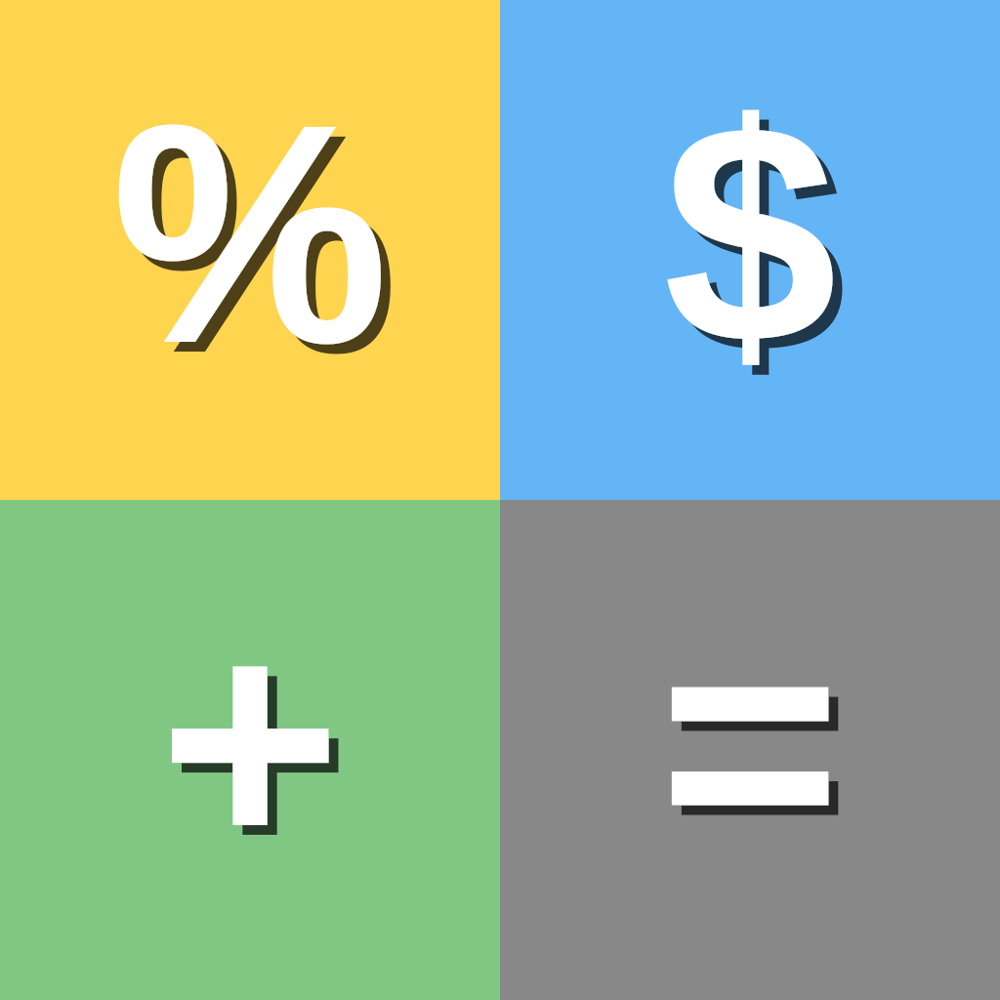

# Compound Interest Calculator



## Introduction

The Compound Interest Calculator is a simple and intuitive web application that allows users to calculate the total gain from compound interest based on their inputs. This application also displays the results in an interactive graph for better visualization. Designed as a Progressive Web App (PWA), it can be used both online and offline, and is fully compatible with mobile devices.

## Features

- **User-Friendly Interface:** Clean and simple design for easy use.
- **Real-Time Calculations:** Immediate results based on user input.
- **Interactive Graphs:** Visual representation of the compound interest over time.
- **PWA:** Installable on mobile devices and usable offline.
- **Responsive Design:** Works seamlessly on desktop and mobile browsers.
- **Multi-Language:** Supports 9 languages (English, Czech, German, Spanish, French, Italian, Polish, Portuguese, Ukrainian).

## Technologies Used

- **HTML:** Structure of the web application.
- **CSS:** Styling and layout.
- **JavaScript:** Logic for calculations and graph generation.
- **Chart.js:** Interactive chart rendering.
- **Service Worker API:** Offline caching and PWA functionality.

## Local Development

To run the project locally, you need an HTTP server (required for the service worker):

```bash
# Using Python
python3 -m http.server 8080

# Using Node.js
npx serve .
```

Then open `http://localhost:8080` in your browser.

## Installation

To use the Compound Interest Calculator as a PWA on your mobile device, follow these steps:

1. Open the application in your mobile browser.
2. Click on the browser menu (usually three dots in the upper right corner).
3. Select "Add to Home screen."
4. Follow the prompts to install the app.

## Usage

1. **Input Data:**
   - Enter the initial principal amount.
   - Enter the monthly deposit amount.
   - Enter the investment period in years.
   - Enter the annual interest rate (as a percentage).

2. **Calculate:**
   - Click the "Calculate" button to see the total gain and the compound interest over time.

3. **View Results:**
   - The results will be displayed in an interactive graph.

## Contributing

Contributions are welcome! Please see [CONTRIBUTING.md](CONTRIBUTING.md) for guidelines on how to contribute, add translations, or report issues.

## Contact

If you have any questions or suggestions, feel free to reach out:

- **Email:** heptau@gmail.com
- **GitHub:** [heptau](https://github.com/heptau)
